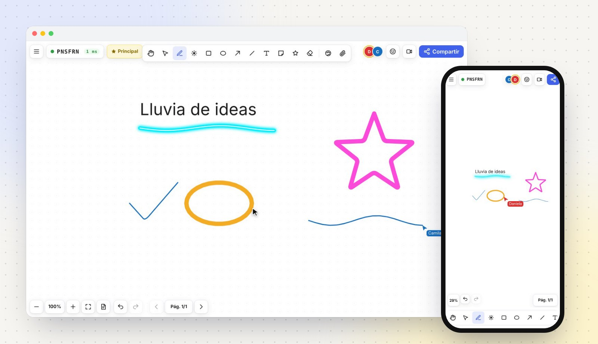
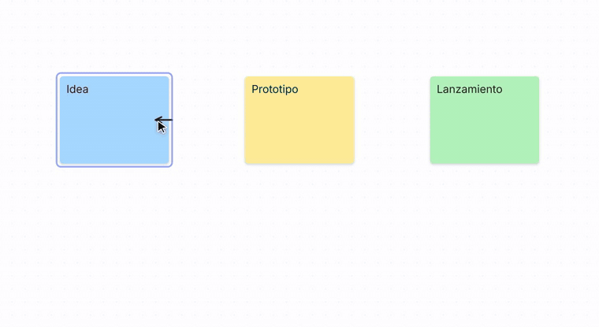
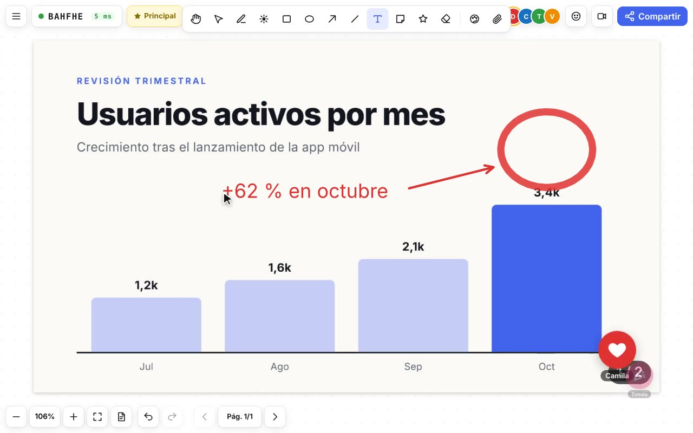
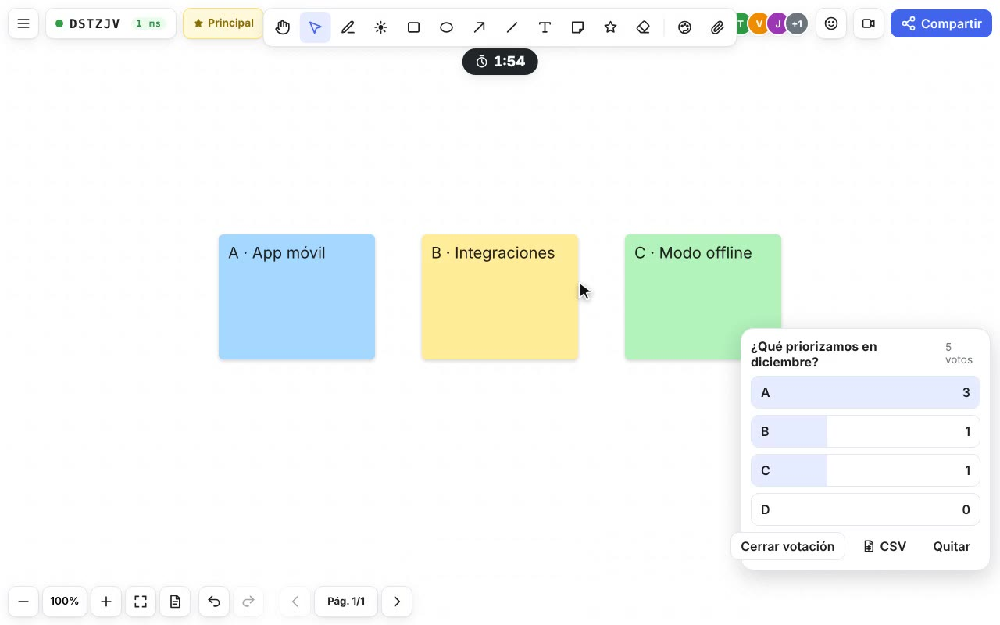
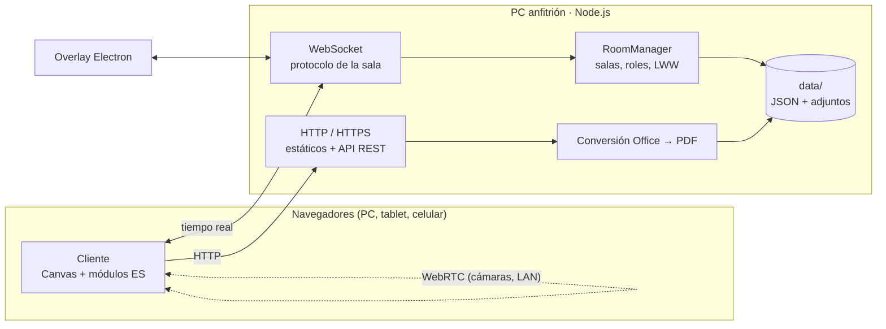

<p align="center">
  
</p>

<h1 align="center">Trazo</h1>

<p align="center">
  <b>La pizarra colaborativa en tiempo real que corre en tu propia red.</b><br />
  Gratis, sin cuentas y sin internet: la inicias en tu PC y todos se unen con un QR desde el celular, la tablet o el computador.
</p>

<p align="center">
  <a href="https://github.com/SonJorell/trazo/actions/workflows/ci.yml"></a>
  
  
  
</p>

<p align="center">
  
</p>

<p align="center">
  <a href="#inicio-rápido">Inicio rápido</a> ·
  <a href="#funciones">Funciones</a> ·
  <a href="#guía-de-uso">Guía de uso</a> ·
  <a href="#desarrollo">Desarrollo</a> ·
  <a href="#solución-de-problemas">Problemas</a> ·
  <a href="CHANGELOG.md">Novedades</a>
</p>

---

## ¿Por qué Trazo?

- **Sin fricción**: nadie crea cuentas ni instala nada. Se escanea un QR y se empieza a dibujar.
- **Tus datos se quedan contigo**: todo corre en tu PC y viaja solo por tu Wi-Fi. Funciona aunque no haya internet.
- **Hecha para clases y reuniones**: presentar PDF y PowerPoint con anotaciones, votar, cronometrar, reaccionar, grabar y dar permisos por rol.

## Funciones

| Área | Qué incluye |
|------|-------------|
| **Dibujo** | Lápiz, marcador, resaltador y **neón**; rectángulo, elipse, línea, **flechas que se pegan a las formas**, texto, notas adhesivas, sellos y borrador. Paleta de 18 colores + personalizado, tamaño y opacidad en %. |
| **Tiempo real** | Los trazos se ven **mientras se dibujan**, con cursores y nombres de cada persona. Indicador de latencia y reconexión automática sin perder lo dibujado. |
| **Páginas y fondos** | Varias páginas con título y miniaturas (mover, duplicar, borrar). Fondos punteado, cuadriculado, rayado, milimetrado, isométrico, pentagrama o liso, también en pizarra negra o verde. |
| **Documentos** | Adjunta fotos, **PDF, PowerPoint, Word y Excel** (se convierten en el PC). Las anotaciones quedan en su página del documento. |
| **Presentar** | Seguir al presentador, puntero láser, notas privadas del presentador, **modo sobre la pantalla** para marcar encima de cualquier programa y **control remoto** de diapositivas desde el celular. |
| **Participación** | Reacciones, **votación rápida** (con exportación a CSV), temporizador y **roles** (visita, editor, presentador) con permisos que hace cumplir el servidor. |
| **Cámaras** | Cámaras de los participantes por WebRTC en la red local: fijas, siguiendo el puntero o como cabeza de un **monigote** que camina por la pizarra. |
| **Guardar y compartir** | Exportar PNG y PDF, **grabar la sesión en video**, **guardar la sala** en un archivo `.trazo` y reabrirla después. |
| **En cualquier equipo** | PC, tablet y celular (desde 360 px), probado en Chrome, Edge, Safari (WebKit) y Firefox. **Se instala como app** (PWA). |

<p align="center">
  
</p>

## Inicio rápido

### Requisitos

- [Node.js](https://nodejs.org) **18.17 o superior** (`node -v`).
- El PC y los demás equipos en la **misma red Wi-Fi**.
- *Opcional*: Microsoft Office o [LibreOffice](https://es.libreoffice.org/) (gratis) en el PC, solo para adjuntar PowerPoint, Word o Excel. Los PDF e imágenes no necesitan nada más.

### Instalar e iniciar

**Windows:** doble clic en **`iniciar.bat`**. La primera vez instala las dependencias.

**Cualquier sistema:**

```bash
git clone https://github.com/SonJorell/trazo.git
cd trazo
npm install
npm start
```

La consola muestra las direcciones y un QR:

```
  En este PC:        http://localhost:3080
  Desde el celular:  http://192.168.1.50:3080
  [código QR]
```

### Primera pizarra en un minuto

1. En el PC abre `http://localhost:3080` y pulsa **Crear pizarra** (*En blanco* o *En directo* para transmitir tu pantalla).
2. Dentro de la pizarra pulsa **Compartir**: aparecen el enlace y el QR.
3. Los demás escanean el QR con la cámara del celular y ya pueden dibujar.

> [!NOTE]
> **Firewall de Windows**: la primera vez Windows pregunta si Node.js puede usar la red. Marca **Redes privadas** y acepta. Si el celular no conecta, revisa que tu Wi-Fi esté marcada como *privada*.

> [!TIP]
> Las salas se cierran solas 2 minutos después de que sale el último participante (`EMPTY_ROOM_TTL_MIN`). Para conservarla, usa **☰ → Guardar la sala (.trazo)**.

## Guía de uso

### Salas, invitaciones y roles

- Cada sala tiene un **código corto**, un enlace y un **QR**. Puedes protegerla con un **PIN** al crearla.
- Quien crea la sala es la **presentación principal** (etiqueta *Principal* con estrella): proyecta, recibe las cámaras y administra permisos. El servidor le entrega una clave que solo guarda ese equipo.
- En **☰ → Participantes y permisos** el anfitrión asigna roles, elige el rol de quien entre desde ahora o cambia a todos a la vez:

| Rol | Puede |
|-----|-------|
| **Visita** | Mirar, reaccionar y votar. Puede *pedir permiso para dibujar*. |
| **Editor** | Además dibujar, escribir, adjuntar, usar el láser, la cámara y el monigote. |
| **Presentador** | Además pasar páginas o diapositivas y cambiar fondos y títulos. |

- **Guardar la sala**: el anfitrión descarga un `.trazo` con páginas, títulos, fondos, notas del presentador, dibujos y adjuntos. En la portada, **Abrir una sala guardada** la recrea como sala nueva (máx. 200 MB). El archivo incluye las notas privadas: compártelo con cuidado.

### Dibujar

- Elige la herramienta en la barra superior; **Colores y grosor** abre el panel de estilo (en el celular, como hoja inferior).
- **Flechas pegadas**: una línea o flecha que empieza o termina sobre una forma, nota, texto, imagen o documento queda pegada y la sigue al moverla. Mantén **Alt** para no pegarla; si mueves solo la flecha, se despega.
- **Notas adhesivas**: se escriben en su lugar y crecen hasta mostrar todo el texto.
- **Bloquear**: selecciona y toca el candado para que nada se mueva al anotar encima.
- En el celular: un dedo dibuja, dos dedos mueven y hacen zoom. **Modo simple** (☰) deja solo lo esencial.

<details>
<summary><b>Atajos de teclado</b></summary>

| Tecla | Acción | Tecla | Acción |
|-------|--------|-------|--------|
| `V` | Seleccionar | `T` | Texto |
| `P` | Lápiz | `E` | Borrador |
| `R` | Rectángulo | `O` | Elipse |
| `A` | Flecha | `L` | Línea |
| `N` | Nota adhesiva | `S` | Sello |
| `K` | Puntero láser | `H` o `Espacio` + arrastrar | Mover vista |
| `Ctrl+Z` / `Ctrl+Y` | Deshacer / rehacer | `Supr` | Eliminar selección |
| `Ctrl+C` / `Ctrl+V` / `Ctrl+X` | Copiar / pegar / cortar | `Ctrl+D` | Duplicar |
| `Ctrl+A` | Seleccionar todo | `Ctrl` + rueda | Zoom |
| `Mayús` al dibujar | Cuadrado, círculo o 45° | `Alt` al dibujar una flecha | No pegarla |
| `←` / `→` | Página del documento activo | Doble toque en un texto | Editarlo |

</details>

### Páginas, fondos y documentos

- **Páginas**: abajo, *‹ Pág. 1/3 ›*. Toca *Pág. N* para ver miniaturas, poner títulos y **mover, duplicar o borrar** páginas.
- **Fondo de la hoja** (☰): para todas las páginas o solo la actual; lo ven todos y sale en las exportaciones. En pizarras oscuras la tinta negra se muestra blanca.
- **Adjuntar** (clip de la barra, ☰, arrastrar y soltar o `Ctrl+V`):

| Archivo | Cómo queda |
|---------|------------|
| Imagen (PNG, JPG, GIF, WebP; en el celular también la cámara) | Imagen que se mueve y agranda |
| PDF, PowerPoint, Word, Excel, OpenDocument | **Documento para hojear** (‹ › en su barra) o **una página por diapositiva** |
| Cualquier otro archivo | Tarjeta que se descarga con doble toque |

Lo que dibujas sobre un documento **queda en esa página** y lo acompaña si lo mueves. Office se convierte a PDF en el PC (Microsoft Office o, si no, LibreOffice). Límites: 40 MB por archivo, 300 MB por sala y 300 páginas por documento.

<table>
  <tr>
    <td></td>
    <td></td>
  </tr>
  <tr>
    <td align="center"><sub>Presentar un PDF y anotarlo</sub></td>
    <td align="center"><sub>Votación rápida con resultados en vivo</sub></td>
  </tr>
</table>

### Presentar

- **Seguir al presentador**: la vista de todos acompaña lo que encuadra el anfitrión; si alguien la mueve, aparece **Seguir** para volver.
- **Puntero láser** (`K`), **reacciones** (botón de carita), **notas del presentador** (solo las ve el anfitrión) y **Borrar mis trazos**.
- **Temporizador** y **votación rápida** en el menú ☰ (Sí/No, A–D, 1–5 u opciones propias; resultados en CSV).
- **Presentar con un clic**: abre tu presentación y haz doble clic en **`presentar.bat`**. Se crea la sala y aparece un QR grande para el público.

<details>
<summary><b>Modo sobre la pantalla (overlay)</b></summary>

Doble clic en **`iniciar-overlay.bat`** (la primera vez descarga Electron, unos 100 MB). Es una capa transparente sobre todo el escritorio para marcar encima de cualquier programa; esa ventana queda como presentación principal.

| Atajo | Acción |
|-------|--------|
| `Ctrl+Shift+D` | Alternar **Dibujar** ↔ **Usar el PC** |
| `Ctrl+Shift+S` | Transmitir / detener la pantalla a la sala |
| `Ctrl+Shift+X` | Limpiar las marcas |
| `Ctrl+Shift+H` | Ocultar / mostrar la capa |
| `Ctrl+Shift+0` | Quitar la lupa |
| `Ctrl+Shift+Q` | Salir |

- **Transmitir**: el público ve la pantalla del PC de fondo y lo que dibuja en el celular aparece en el mismo lugar del PC. La capa no sale en la captura y solo se envían cuadros si alguien mira.
- **Marcas**: *por diapositiva* (vuelven al regresar), *se borran* o *se quedan* al pasar de diapositiva.
- **Personas → Permitir a todos** deja pasar diapositivas sin aprobar uno por uno.
- Usa la transmisión solo en redes de confianza.

</details>

<details>
<summary><b>Control remoto y pasar diapositivas</b></summary>

Requiere el overlay abierto en el PC.

1. En la barra del overlay pulsa **Control remoto** y escanea el QR con tu celular. **Ese QR lleva una clave secreta: no lo muestres al público.**
2. Deja la presentación (PowerPoint, Google Slides, PDF, Canva o HTML) en primer plano.
3. En el celular: anterior/siguiente (o desliza), iniciar (F5), inicio, fin, negro, blanco y salir; teclas de *Flechas*, *AvPág* o *Espacio*.
4. **Lupa**: toca un punto para ampliarlo 2×, pellizca para cambiar el zoom y activa *Ver pantalla* para ver el PC en el celular.

Un participante también puede pedir **☰ → Pedir pasar diapositivas**; el anfitrión lo permite, lo rechaza o lo quita desde el icono de personas.

</details>

### Cámaras y monigote

- Comparte la sala con **Compartir**: el QR apunta a **HTTPS** (`https://IP:3443`), porque el celular solo permite la cámara en páginas seguras. La primera vez el navegador avisa que la conexión «no es privada» (es el certificado local de tu PC): **Avanzado → Continuar** (en iPhone: *Mostrar detalles → visitar el sitio*).
- Cada persona enciende su cámara con el botón de cámara y elige en **☰ → Mi cámara y avatar** su forma y dónde se ve: fija, **siguiendo su puntero**, en un lugar de la pizarra o como **monigote** (con color, figura y accesorios) que camina, salta, se sienta en sillas y hace gestos al reaccionar.
- **☰ → Ver las cámaras de todos**: cada cámara llega a la presentación en calidad completa y hasta a 8 espectadores en calidad reducida, directo por la red local y sin audio.

### Grabar la sesión

**☰ → Grabar la sesión**: elige **La pizarra** (dibujos, fondo, monigotes y cámaras; funciona en el celular) o **Una pantalla o ventana**, con micrófono opcional. Al detener, el video (MP4 o WebM según el navegador) se descarga en tu equipo; no pasa por el servidor.

### Instalar como app

En el PC abre `http://localhost:3080` y usa **Instalar app** (portada o menú): Trazo queda con su icono y ventana propios, y muestra una página sin conexión si se cae la red. En el celular, por la red local, usa *Agregar a pantalla de inicio* del navegador (los navegadores solo permiten instalar desde `localhost` o HTTPS de confianza).

## Configuración

Variables de entorno (plantilla en [`.env.example`](.env.example)):

| Variable | Por defecto | Descripción |
|----------|-------------|-------------|
| `PORT` | `3080` | Puerto HTTP y WebSocket |
| `HTTPS_PORT` | `3443` | Puerto HTTPS local (cámaras en el celular); `0` lo desactiva |
| `HOST` | `0.0.0.0` | `127.0.0.1` para que solo funcione en este PC |
| `DATA_DIR` | `data` | Carpeta de salas y adjuntos |
| `EMPTY_ROOM_TTL_MIN` | `2` | Minutos que una sala vacía sigue abierta antes de borrarse |
| `SWEEP_INTERVAL_MS` | `30000` | Cada cuánto se revisan las salas vacías |
| `LOG_LEVEL` | `info` | `debug`, `info`, `warn`, `error`, `silent` |
| `SOFFICE_PATH` | — | Ruta a `soffice` si LibreOffice no está en el lugar habitual |
| `TRAZO_NO_MSOFFICE` | — | `1` para convertir solo con LibreOffice |

Ejemplo en Windows: `set PORT=3090 && npm start` · en macOS/Linux: `PORT=3090 npm start`.

## Desarrollo

### Arquitectura

Un solo proceso Node.js sirve el cliente, la API REST y el canal en tiempo real. El cliente es HTML, CSS y módulos JavaScript nativos, sin paso de compilación. Cada elemento de la pizarra se sincroniza con la regla *last-writer-wins* por versión, idéntica en servidor y clientes (`shared/`).



Detalle de módulos, protocolo y reglas de dependencia en [docs/arquitectura.md](docs/arquitectura.md).

### Estructura

```
server/    Servidor: HTTP, WebSocket, salas, persistencia, adjuntos y conversión de Office
shared/    Modelo, geometría, flechas pegadas y protocolo (servidor y navegador)
public/    Cliente sin compilación: HTML, CSS y módulos JS
overlay/   App de escritorio (Electron) para dibujar sobre la pantalla
tests/     Pruebas unitarias e integración (node:test) y de punta a punta (tests/e2e)
docs/      Requerimientos, arquitectura, decisiones (ADR), informe y análisis
.github/   Integración continua y plantilla de pull request
```

### Scripts

| Comando | Descripción |
|---------|-------------|
| `npm start` | Inicia el servidor |
| `npm run dev` | Inicia y reinicia al guardar cambios |
| `npm test` | Pruebas unitarias y de integración |
| `npm run lint` | Revisa el estilo con ESLint |
| `npm run check` | Lint + pruebas (lo mismo que exige la CI) |
| `npm run overlay` | Instala Electron si falta y abre el modo sobre la pantalla |

### Pruebas de punta a punta

Con el servidor corriendo y Python con Playwright (`pip install playwright && python -m playwright install chromium`):

```bash
TRAZO_URL=http://localhost:3080 python tests/e2e/v28.py           # flechas pegadas, guardar/abrir sala
TRAZO_URL=http://localhost:3080 python tests/e2e/sesion_completa.py
TRAZO_BROWSER=webkit python tests/e2e/navegadores.py             # WebKit (Safari) o firefox, vía Selenium
```

Cada archivo de `tests/e2e/` explica en su cabecera qué cubre y qué necesita. Todas corren en **GitHub Actions** en cada *push* y *pull request* (Node 20 y 22; Chrome, Firefox y WebKit), y guardan capturas como artefactos.

### Contribuir

1. Crea una rama desde `develop`: `feature/<tema>` (`main` es la versión estable).
2. Usa commits semánticos: `feat:`, `fix:`, `docs:`, `refactor:`, `test:`, `chore:`.
3. Antes del pull request: `npm run check` en verde y, si cambia la interfaz, una prueba en `tests/e2e/`.
4. Otra persona revisa el pull request antes de integrarlo. Las decisiones de diseño nuevas se registran como ADR en [docs/decisiones.md](docs/decisiones.md).

## Solución de problemas

| Problema | Solución |
|----------|----------|
| El celular no abre la página | Misma Wi-Fi; permite Node.js en el firewall (redes privadas); usa la IP de la consola, no `localhost` |
| «La conexión no es privada» | Es el certificado local del PC: *Avanzado → Continuar*. Se necesita para la cámara |
| La cámara no aparece | Abre la sala por `https://…:3443`, permite la cámara en el celular y revisa el firewall |
| «El puerto 3080 está ocupado» | Cierra la otra ventana de Trazo o usa otro puerto (`PORT=3090`) |
| Varias IP en la consola | Usa la que empieza por `192.168.` (suele ser la Wi-Fi) |
| No se convierte un PowerPoint | Instala LibreOffice o indica su ruta con `SOFFICE_PATH`; mientras tanto, exporta a PDF y adjunta el PDF |
| Se perdió la conexión | Se reconecta sola; lo dibujado mientras tanto se envía al volver |
| No aparece «Instalar app» | Solo se ofrece en `localhost` o HTTPS de confianza; en el celular usa *Agregar a pantalla de inicio* |

## Documentación

- [Historial de versiones](CHANGELOG.md)
- [Requerimientos, MVP y backlog](docs/requerimientos.md)
- [Arquitectura y protocolo](docs/arquitectura.md)
- [Bitácora de decisiones (ADR)](docs/decisiones.md)
- [Informe del proyecto](docs/informe.md)
- [Análisis de mejoras y hoja de ruta](docs/analisis-mejoras.md)

## Licencia

[MIT](LICENSE). Úsala, modifícala y compártela libremente.
