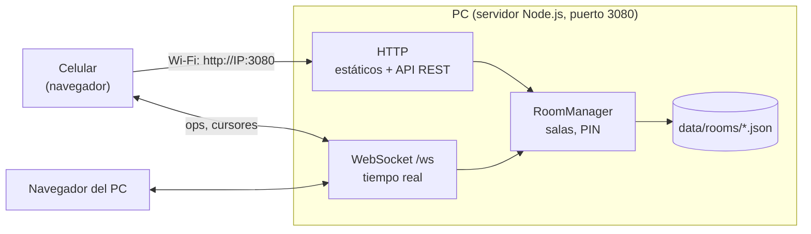
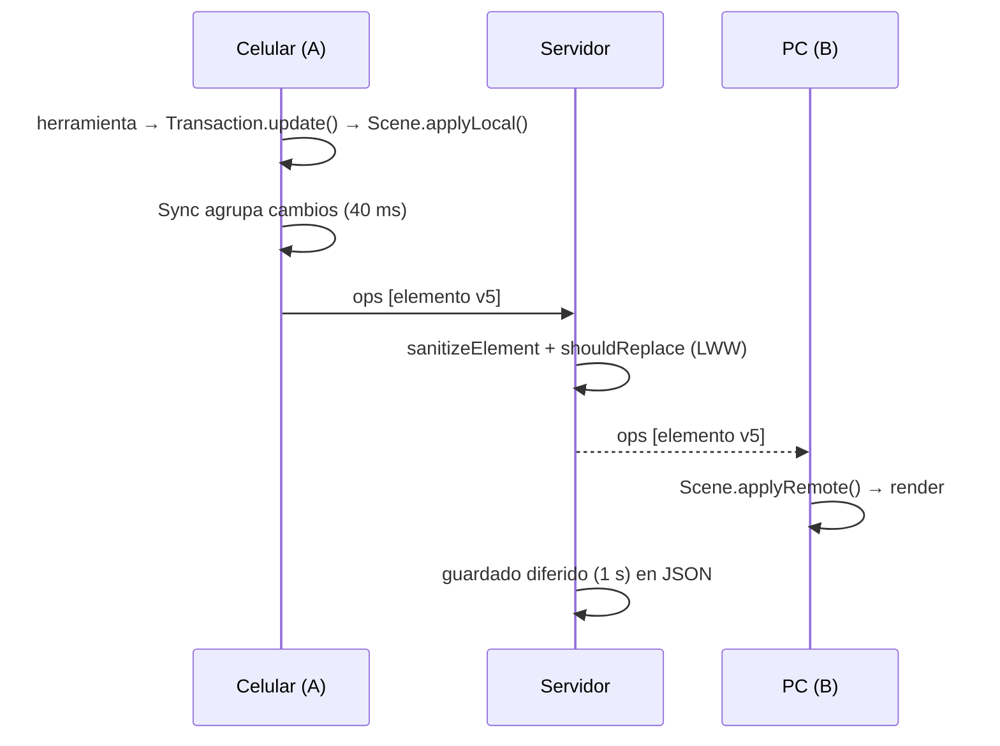
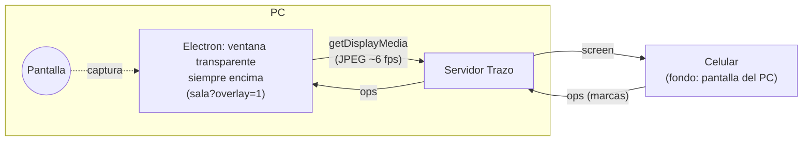

# Arquitectura de Trazo

## 1. Vista general



Un único proceso Node sirve el cliente, la API y el canal en tiempo real. Los dispositivos de la
misma red se conectan con la IP del PC. No hay servicios externos.

## 2. Estructura de carpetas

```
trazo/
├── server/                 Servidor (Node.js, módulos ES)
│   ├── index.js            Punto de entrada: arranca, muestra URLs y QR, apagado limpio
│   ├── app.js              Ensambla HTTP + WebSocket + salas (inyección de dependencias)
│   ├── config.js           Configuración por variables de entorno
│   ├── http/               static.js (archivos), api.js (REST + QR)
│   ├── realtime/           socketServer.js (protocolo), rateLimiter.js (token bucket)
│   ├── rooms/              Room.js (estado), RoomManager.js (ciclo de vida), pin.js (scrypt)
│   ├── storage/            FileStore.js (JSON en disco), MemoryStore.js (pruebas)
│   └── util/               logger.js, network.js (IPs de la red local)
├── shared/                 Código usado por servidor Y navegador
│   ├── elements.js         Modelo, saneo y regla LWW
│   ├── geometry.js         Límites y pruebas de impacto
│   └── protocol.js         Tipos de mensaje, errores y validaciones
├── overlay/                App de escritorio (Electron): main.js, preload.cjs, icon.png
├── public/                 Cliente (HTML/CSS/JS nativo, sin compilación)
│   ├── index.html          Inicio: crear / unirse / recientes
│   ├── board.html          Pizarra
│   ├── css/styles.css
│   └── js/
│       ├── board/main.js   Orquestador de la pizarra
│       ├── core/           scene.js, history.js (deshacer + transacciones), viewport.js, handles.js
│       ├── render/         renderer.js, draw.js, exportPng.js
│       ├── tools/          select, pen, shape (rect/elipse/línea/flecha), text, eraser, hand
│       ├── input/          pointer.js (ratón, lápiz, táctil, pellizco, rueda)
│       ├── net/            connection.js (reconexión), sync.js (puente escena ↔ red)
│       ├── overlay/        overlayMode.js (modo sobre la pantalla), screenShare.js (captura)
│       ├── ui/             barra, panel de estilo, presencia, diálogos, editor de texto, avisos
│       └── util/           api.js, storage.js, emitter.js
├── tests/                  Pruebas con node:test (unitarias + integración)
└── docs/                   Requerimientos, arquitectura, decisiones, informe
```

### Reglas de dependencia (diseño modular)

- `shared/` no depende de nada.
- `server/rooms` no sabe de HTTP ni WebSocket; `server/realtime` y `server/http` usan `rooms`.
- `RoomManager` solo conoce la interfaz del almacén (`init/exists/load/save`). Cambiar a SQLite o
  Redis = nueva clase con esa interfaz.
- En el cliente, las herramientas solo usan el objeto `ctx` (escena, vista, estilo, transacciones);
  no tocan la red ni el DOM. La red solo escucha eventos de la escena.

## 3. Modelo de datos

```js
{
  id: 'aB3xK9...',          // 12 caracteres aleatorios
  type: 'pen' | 'rect' | 'ellipse' | 'line' | 'arrow' | 'text',
  version: 7,               // sube con cada edición
  nonce: 123456,            // desempate aleatorio
  isDeleted: false,         // borrado lógico
  z: 1731171234567.42,      // orden de apilado
  x, y,                     // origen en coordenadas del mundo
  w, h,                     // rect / elipse / texto
  points: [[0,0],[5,3]],    // pen / line / arrow (relativos a x,y)
  text, fontSize,           // texto
  stroke: '#1e1e1e', fill: 'transparent', strokeWidth: 2
}
```

Archivo de sala (`data/rooms/<código>.json`):
`{ id, createdAt, pin: { salt, hash } | null, elements: [...] }`.

## 4. Protocolo en tiempo real

| Dirección | Mensaje | Contenido |
|-----------|---------|-----------|
| C → S | `join` | `room`, `name`, `pin?` |
| S → C | `welcome` | `you`, `peers`, `elements` (estado completo) |
| C → S | `ops` | `ops: Element[]` (hasta 500 por mensaje) |
| S → C | `ops` | `from`, `ops` aceptados |
| C ↔ S | `cursor` | `x`, `y` (y `id` al reenviar) |
| S → C | `peer-join` / `peer-leave` | participante |
| C → S | `screen` | `w`, `h`, `data` (JPEG en data URL, ≤480 000 caracteres) |
| S → C | `screen` | `from`, `w`, `h`, `data` (descartable si el cliente va atrasado) |
| C ↔ S | `screen-stop` | fin de la transmisión (también al desconectarse quien transmite) |
| S → C | `error` | `code`, `message`; los de sala/PIN cierran la conexión |

### Flujo de una edición



### Convergencia

- Regla LWW por elemento (`shared/elements.js#shouldReplace`), idéntica en servidor y clientes.
- Al reconectar, el cliente recibe el estado completo, lo fusiona y reenvía lo que tenga más nuevo
  (lo dibujado sin conexión no se pierde).
- Deshacer = aplicar el estado anterior como edición nueva → se propaga como cualquier cambio.

## 5. Modo sobre la pantalla (v1.1)



- `overlay/main.js` crea la ventana, registra los atajos globales y la bandeja, y responde a
  `getDisplayMedia` con la pantalla principal sin mostrar diálogo.
- `overlay/preload.cjs` expone solo `window.trazoOverlay` (modo, interactividad, ocultar, salir).
- En la página, `overlayMode.js` arma la barra de control y pide a Electron que deje pasar los clics,
  salvo sobre las zonas interactivas (`.ov-hit`). `screenShare.js` envía los cuadros.
- Los visores guardan el último cuadro en `overlay.screen` y el renderizador lo dibuja bajo los
  elementos en `(0,0,w,h)`.

## 6. Seguridad

| Riesgo | Mitigación |
|--------|------------|
| Datos maliciosos | `sanitizeElement` copia solo campos conocidos, valida tipos, colores y límites |
| Recorrido de rutas | códigos de sala con `^[a-z0-9]{4,24}$`; el servidor estático verifica que la ruta quede dentro de la carpeta |
| Fuerza bruta / abuso | token bucket por conexión (ráfaga 200, 120 msg/s), `maxPayload` 512 KB, máx. 500 ops por mensaje |
| PIN expuesto | `scrypt` + sal, comparación en tiempo constante, nunca en texto plano |
| XSS | el cliente nunca inserta texto de usuarios como HTML (`textContent` / canvas) |
| QR abierto | `/api/qr.svg` solo genera códigos de URLs de este mismo servidor |
| Conexiones colgadas | latido ping/pong cada 30 s |
| Cuadros de pantalla falsos | solo `data:image/jpeg;base64`, tamaño y dimensiones acotados |
| Overlay navegando a otro sitio | Electron bloquea navegación fuera de Trazo y ventanas nuevas; `contextIsolation` + `sandbox` |

## 7. Stack tecnológico y justificación

| Pieza | Elección | Motivo |
|-------|----------|--------|
| Servidor | Node.js ≥ 18, `http` nativo | Ya instalado en el equipo; un proceso para todo |
| Tiempo real | `ws` | Librería WebSocket estándar, sin dependencias nativas |
| QR | `qrcode` | Genera QR en terminal y SVG, JavaScript puro |
| Cliente | HTML + CSS + JS (módulos ES), Canvas 2D | Sin compilación; funciona en cualquier navegador moderno |
| Persistencia | Archivos JSON | Cero instalación; intercambiable |
| Pruebas | `node:test` | Incluido en Node, sin dependencias |
| Overlay | Electron (opcional, carpeta aparte) | Única vía práctica para una ventana transparente, siempre encima y con clics pasantes |
| Calidad | ESLint 9 + EditorConfig | Reglas comunes para todo el equipo |
